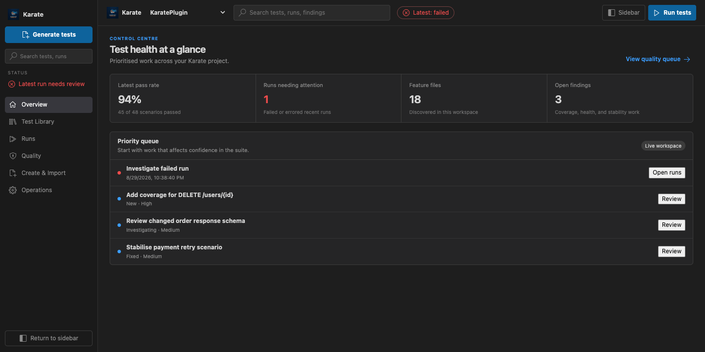

# Karate Test Management for VS Code

Generate, run, manage, and improve Karate API tests without leaving VS Code.

[](https://marketplace.visualstudio.com/items?itemName=MuthuKumarKoodalingam.karate-test-generator)
[](https://code.visualstudio.com/)
[](LICENSE)



Karate Test Management brings test creation, execution, coverage, quality, and maintenance into one professional workspace. Use the compact Activity Bar view for quick actions, then open the expanded workspace when you need the full test library, run history, quality queue, or import tools.

## Version 2.0.4 highlights

2.0.4 moves OpenAPI, requirements, imports, Scout, and MCP generation onto the same Karate 2.x-focused path. It creates a reviewable project layout, uses contract evidence for runnable scenarios, makes uncertain work explicit `@ignore` drafts, and preserves edited output during regeneration. The detailed behavior, configuration reference, and limitations are in the [generation guide](docs/generation.md).

### Generation quality at a glance

- **OpenAPI and combined OpenAPI + Confluence** create contract-derived features with positive, negative, edge, boundary, and security categories (plus opt-in exploratory scenarios), declared-status assertions, schemas/data where planned, and CRUD chaining when enabled. Combined generation appends traceable requirements drafts where the requirements cannot be mapped honestly to a contract operation.
- **Confluence and Jira** turn acceptance criteria into traceable Karate scenarios when they can be mapped to a contract; otherwise they produce `@ignore` drafts rather than invent an API request.
- **Postman, HAR/session, and GraphQL** preserve the supplied request flow or schema evidence in Karate features. HAR/session output is `<slug>/<slug>.feature` with the `domain` layout; `flat` and `method` layouts emit `<slug>.feature`. GraphQL scenarios use the supplied operations, variables, schema, and data/errors assertions.
- **Directory batch** namespaces each specification’s output to avoid collisions. **Scout** saves its journey suite through the gate and protected writer. **MCP `generate_tests`** uses the same scaffold and writer, returns the generated files, and always emits the safe Background.
- **Spec-diff/sync, coverage-dashboard append, and AI enhance/repair** are protected too: legacy sync gates its compatibility output and writes a review sibling; coverage append rejects new gate errors and uses a sibling when the target is not a consistent generated file; AI keeps deterministic output when refinement is rejected.

Every pipeline-backed mode follows: adapter → normalized model → planner → renderer → scaffolder → optional AI refiner → quality gate → protected writer → optional staged Karate v2 dry run.

### Sample generated project (default `domain` layout)

```text
src/test/java/
  karate-config.js
  karate-config-dev.js
  karate-config-staging.js
  common/
    auth.feature                 # only when the spec declares security schemes
    utils.feature
  data/
    pets.json
  schemas/
    pets.json
src/test/karate/
  pets/
    pets.feature
    pets-security.feature
```

Existing `karate-config*.js` files are adopted, not overwritten. `common/auth.feature` and `common/utils.feature`, plus data and schema files, are user-owned after creation. Credentials are read through `karate.sysenv(...)` or system properties; they are not generated into files.

### Project configuration

Workspace `.karate-generator.json` values override VS Code settings, which override built-in defaults. This is a valid compact configuration using only supported schema fields:

```json
{
  "layout": { "outputRoot": "src/test/karate", "strategy": "domain", "classpathRoot": "src/test/java" },
  "config": { "mode": "standard", "urlVariable": "baseUrl", "envs": ["dev", "staging"] },
  "tags": { "auto": true },
  "scenarios": { "categories": ["positive", "negative", "security"], "exploratory": false, "crud": true },
  "data": { "smart": true, "externalize": true },
  "ai": { "refine": true, "maxRetries": 1, "chunk": "feature" },
  "gate": { "dryRun": "auto", "failOn": "error" }
}
```

Legacy generation settings are still read when the config file does not override them. In particular, `testTemplate: detailed` maps to opt-in exploratory scenarios, while `minimal` maps to positive and negative categories only.

### Quality gate and rule IDs

Before output is written, the gate checks Karate v2 structure, URLs/configuration, secrets, assertions, drafts, duplicate names, unsafe APIs/numbers, classpath references, tag taxonomy, and auth-helper reuse. The same findings appear in the editor as **Karate Gate** diagnostics. `V2-LOCK-001` also offers the `@parallel=false` → `@lock=<name>` quick fix. A Karate v2 dry run is staged when a v2 CLI is found; otherwise it is reported as skipped, not passed.

See [the full rule table and dry-run semantics](docs/generation.md#quality-gate), including `V2-AI-*` refinement checks.

### Regeneration and your edits

Generated features contain a body hash in their header. An unchanged generated file is updated; an edited file is kept and new output is written beside it as `<name>.generated.feature`. If that sibling is also edited, the writer continues the chain (`.generated.generated.feature`). Absolute paths, `..` traversal, and unsafe symlink writes are rejected. A failed dry run never replaces the existing feature; it produces a draft sibling for review.

If you maintain `common/auth.feature`, declare the supported OpenAPI security-scheme names in `# Configures: schemeName, otherScheme`. The generator uses that contract to draft secured operations it cannot verify.

### Upgrading to 2.0.4

- Use Karate 2.x with Java 21 or later. Set `karateDsl.execution.jarPath` or `karateDsl.execution.karateVersion`; the bundled 1.5.0.RC3 jar cannot run generated v2 suites.
- Add `.karate-generator.json` for project-level layout, configuration, scenario, AI, and gate choices.
- Expect edited generated features to receive `.generated.feature` review siblings.
- Replace `@parallel=false` with `@lock=<name>` (the migration/quick fix can help).
- Treat the current real-v2-run limitations in [the generation guide](docs/generation.md#known-limitations-and-manual-acceptance) as open verification work.

## Version 2.0.3 highlights

- **Karate Scout** — sign in normally in Chrome or Edge, teach a journey, explore confirmed variations, and generate linked API tests. An optional browser companion connects existing signed-in tabs. Browser verification and independent Karate verification are separate. [Scout setup and sample checkout](docs/scout.md).
- **One management workspace** — Overview, Test Library, Runs, Quality, Create & Import, and Operations share one consistent interface.
- **Compact and expanded views** — stay productive in the sidebar or move into a full editor tab for data-dense workflows. **Open** always creates or focuses the full workspace, while area changes in the sidebar keep both views synchronized.
- **Reliable project-aware execution** — automatically discovers simple projects, Maven modules, Gradle modules, and configured custom runners.
- **Exact scenario runs** — CodeLens and editor actions target the selected scenario by source line and exact name.
- **Actionable quality queue** — organize coverage gaps, specification changes, health issues, flaky tests, and failures from New through Verified.
- **Searchable test library** — browse scenarios with tags, ownership, lifecycle status, stability, and Zephyr traceability.
- **Flexible coverage analysis** — analyze an OpenAPI specification on its own, or add feature files for exact scenario-to-endpoint mapping.
- **Safer shared state** — workspace metadata uses Git-friendly UUID entity files with multi-root isolation and retained run history.
- **Local, theme-aware UI** — bundled assets, strict content security, keyboard navigation, and native VS Code light/dark theme support.
- **Unified AI routing** — every AI-assisted workflow uses one selected provider, focused Karate instructions, and the same validation guardrails.
- **Quota-conscious Copilot** — live model discovery replaces stale model lists; efficient routing is the default and highest-quality models require explicit selection.
- **One AI choice per workflow** — the Create & Import checkbox is carried through the complete run, so Postman and HAR imports no longer ask the same AI question again after file selection.
- **Visible progress for every long-running action** — generation, imports, execution, analysis, repair, Bug Hunter, and exports acknowledge the click immediately, show ongoing activity, and prevent accidental duplicate starts.

All existing command IDs remain available. Several generation settings are deprecated in favor of `.karate-generator.json`; they still work.

## What you can do

| Workflow | Capabilities |
|---|---|
| Teach with Scout | Chrome/Edge journeys, existing signed-in tabs, live action/API maps, confirmed variations, and linked Karate suites |
| Create and import | OpenAPI, OpenAPI + Confluence, Confluence, Postman, HAR, GraphQL, Jira, and recorded sessions |
| Execute | Feature, exact scenario, folder, tags, saved profiles, environments, and parallel workers |
| Manage | Indexed scenario library, run history, failure drill-down, rerun, repair review, ownership, and Zephyr links |
| Improve quality | OpenAPI coverage, missing-test generation, project health, flakiness, specification change impact, and Bug Hunter |
| Automate | GitHub Actions repair intake, Zephyr Scale result publishing, MCP tools, and shared generation styles |

## Meet Karate Scout

**Sign in normally, show Scout how your app works, and watch it build and test the journey.**

Choose **Karate Scout: Teach a Browser Journey** in the Command Palette, or open **Scout** in Test Management. Select Chrome or Edge, sign in, then start teaching after you reach your application. The optional companion connects an existing signed-in tab where browser policy permits it.

1. Demonstrate one REST/JSON journey and watch its actions and API calls appear together.
2. Confirm expected behavior and dynamic data links. Provide a reset procedure or fresh data before state-changing exploration.
3. Review the proposed variations, execute the ones you confirm, and inspect evidence when an assertion fails.
4. Save the linked Karate suite, configure the application's supported API authentication fixture, and verify it independently.

**Verified in browser** and **Verified in Karate** are separate outcomes. Browser sign-in is not copied into generated files. HAR imports are inferred API sequences, and company-managed SSO/passkey compatibility still requires a pilot.

Select **Try the sample shop** to find a seeded duplicate-checkout defect. [Setup and companion installation](docs/scout.md) · [Validation results and release boundaries](docs/scout-validation.md) · [Product site](https://mov2day.github.io/KaratePlugin/).

## Quick start

### Install

Install **Karate Test Management** from the [Visual Studio Marketplace](https://marketplace.visualstudio.com/items?itemName=MuthuKumarKoodalingam.karate-test-generator), then open a folder containing Karate `.feature` files or an API specification.

### Open the workspace

1. Select the Karate application icon in the Activity Bar.
2. Use the compact sidebar for search, status, generation, and run actions.
3. Select **Open** to launch the expanded Test Management workspace. If it is already open, the same action brings it back into focus from any editor tab.

When you change areas in the compact sidebar, **Open** receives a brief, subtle highlight as a reminder that the current area is also available in the full workspace.

### Create tests

Open **Create & Import** and choose a source. The guided flow keeps source selection, scenario intent, templates, and optional AI enhancement together.

You can also right-click a supported file and choose the relevant Karate command:

- OpenAPI: `.json`, `.yaml`, `.yml`
- Postman: collection JSON
- HAR: `.har`
- GraphQL: `.graphql`, `.gql`, or introspection JSON

### Run tests

- Select **Run Feature** above a `Feature:` declaration.
- Select **Run Scenario** above a `Scenario:` or `Scenario Outline:` declaration.
- Run a folder or tag selection from the command palette or the Runs area.
- Save repeatable run profiles with an environment and worker count.

The executor inspects the target feature and surrounding project before choosing a strategy:

1. A configured runner class and method, when provided.
2. The nearest Maven or Gradle module and discovered runner.
3. The standalone Karate CLI for simple projects.

### Analyze coverage

Open **Quality** and select **Analyze coverage**.

- Choose an OpenAPI specification to measure contract coverage.
- Feature files are optional. Add them when you want exact scenario mapping and evidence.
- Review covered and uncovered endpoints, then generate missing tests from the gaps.

## Test management workspace

### Overview

See the latest pass rate, failed runs, discovered features, open findings, and a prioritized work queue.

### Test Library

Search the indexed scenario inventory and manage tags, ownership, lifecycle status, flakiness, source location, and Zephyr keys.

### Runs

Create run profiles, select environments, follow active execution, inspect history and trends, compare runs, open failed scenarios, and review AI-assisted repairs before applying them.

### Quality

Keep coverage, project health, flakiness, and specification changes in a managed workflow:

`New → Investigating → Fixed → Verified`

Invalid transitions are blocked so findings cannot skip required review stages.

### Create & Import

Generate deterministic Karate 2.x tests and optionally refine them through a configured AI provider. Output follows one project layout and is checked by a quality gate before it is written; configure it in `.karate-generator.json` (see [docs/generation.md](docs/generation.md)).

When generation or import starts, the selected action changes to a busy state and the workspace displays a compact progress strip. Workflows with measurable stages also report their current percentage.

### Operations

Access Bug Hunter, CI repair, Zephyr publishing, credentials, settings, learned styles, generation history, and the user-invoked bug reporter.

## Execution configuration

Automatic discovery works for most projects. Use these settings only when your repository needs explicit control.

| Setting | Purpose |
|---|---|
| `karateDsl.execution.buildTool` | Select `auto`, `maven`, `gradle`, or `cli` |
| `karateDsl.execution.runnerClass` | Fully qualified Maven/Gradle runner class |
| `karateDsl.execution.runnerMethod` | Optional JUnit runner method |
| `karateDsl.execution.mavenGoal` | Maven goal used for execution |
| `karateDsl.execution.gradleTask` | Gradle task used for execution |
| `karateDsl.execution.configPath` | Custom `karate-config.js` file or containing directory |
| `karateDsl.execution.parallelism` | Parallel worker count |
| `karateDsl.execution.systemProperties` | JVM `-D` properties such as `karate.env` |
| `karateDsl.execution.jvmArgs` | Additional JVM arguments |
| `karateDsl.execution.karateArgs` | Additional Karate CLI arguments |
| `karateDsl.execution.jarPath` | Exact local standalone Karate JAR |
| `karateDsl.execution.karateVersion` | Download and cache a selected standalone Karate version |
| `karateDsl.execution.historyLimit` | Number of v2 run-history entries retained per workspace folder |

Karate 2.x standalone execution requires Java 21 or later. Leaving `jarPath` and `karateVersion` blank uses Karate `1.5.0.RC3` for compatibility; the extension no longer ships a jar and, with your consent, downloads it from GitHub Releases on first run (SHA-256 verified, cached in VS Code's global storage). The generation quality gate's dry-run uses only a Karate v2 CLI (`karate` on `PATH`, or a v2 jar set in `jarPath`) and is skipped when none is found; the downloaded v1 jar is never used for it.

## AI providers

AI enhancement is optional. The extension supports:

- GitHub Copilot as the default provider, with live model discovery and efficient, balanced, or explicit highest-quality routing
- Other language-model providers registered with VS Code
- Claude API credentials stored in VS Code SecretStorage
- Installed local Ollama models discovered from the running Ollama service

Run **Karate: Configure AI Routing** to choose one provider for generation, imports, coverage guidance, repair, flakiness analysis, and suggestions. Copilot's default **Efficient** mode routes lightweight analysis to fast families such as Haiku or Luna while reserving balanced families such as Sonnet or Terra for production Karate generation. Select an exact live model or **Highest quality** only when the additional quota use is intentional.

Provider selection is strict. If a selected model becomes unavailable, routing refreshes the live model list and retries with another eligible model from that same provider. It never moves a Copilot request to Claude or Ollama, or changes any other selected provider implicitly. The legacy provider value `auto` is retained as a Copilot alias for existing settings.

| Copilot policy | Selection behavior | Recommended use |
|---|---|---|
| Efficient (default) | Uses fast/low-cost families for lightweight work and balanced/medium-cost families for generation and repair | Routine generation, conversion, coverage, and suggestions |
| Balanced | Uses balanced-capability families for every AI task | Consistent production generation without automatic premium escalation |
| Highest quality | Uses deep-reasoning families such as Opus or Sol | Explicit, occasional use when quality matters more than quota |
| Exact model | Prefers the selected live model, then falls back within the active cost policy if it is unavailable or cannot fit | Reproducible team or troubleshooting workflows |

The available Copilot model list comes from the current VS Code Language Model API at selection and request time. Automatic routing recognizes stable family names rather than hardcoding complete versioned IDs, so new Sonnet, Opus, Luna, Terra, and Sol releases inherit the appropriate tier. Unknown future families remain available for exact manual selection but are not assigned an automatic cost tier. If an explicitly selected model is no longer available or cannot fit the request, selection is recalculated under the active policy. Efficient and Balanced routing never escalate automatically to a deep/high-cost family.

Within **Create & Import**, **Enhance this run with AI** is the source of truth for that run. Its value is forwarded to supported OpenAPI, Confluence, combined, Postman, and HAR flows. Command Palette and Explorer launches still ask when no inline choice was available, preserving the existing standalone workflow.

AI prompts are composed for the active Karate task. Contract generation, Postman conversion, coverage analysis, scenario repair, flakiness investigation, and reusability review each receive focused instructions instead of one oversized generic knowledge block.

Deterministic generation, execution, coverage, and management workflows remain available without an AI provider.

## Safety and privacy

- Credentials are stored through VS Code SecretStorage.
- Sensitive values are redacted from extension logs and AI activity records.
- Bug Hunter permits localhost by default; other hosts require an explicit allowlist.
- Destructive Bug Hunter methods remain disabled unless you explicitly enable them.
- AI-suggested repairs require review unless you deliberately enable auto-apply.
- **Karate: Report a Bug** is user-invoked. Its public GitHub issue excludes raw diagnostic logs.

## Support

- Run **Karate: Report a Bug** from the command palette.
- Open an issue in the [GitHub repository](https://github.com/mov2day/KaratePlugin/issues).
- Include the extension version, execution strategy, and a minimal reproducible project structure when reporting run issues.

## License

[MIT](LICENSE)
