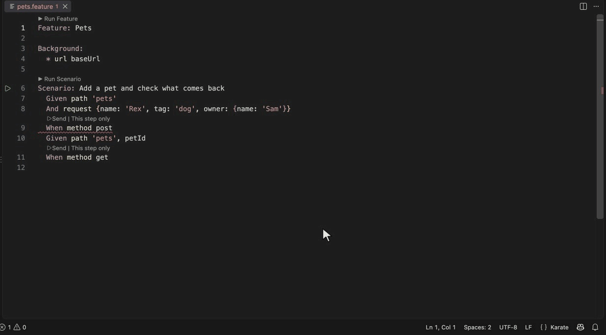

# Karate Workbench

Run a Karate scenario one step at a time from the editor, see the real response beside your code, and click a field to write the assertion. Everything Workbench writes is ordinary Karate in your own `.feature` file.

Workbench needs **Karate 2.1 or newer** and **Java 21 or newer**. It runs your project's real `karate-config.js`, so `baseUrl`, headers, `callSingle` authentication, Java helpers and environments behave exactly as they do in a normal run.

## Try it

1. Open a `.feature` file with a `Scenario`.
2. Click **Send** above a `method` step, or put the cursor on any step and run **Karate Workbench: Run to Cursor** from the Command Palette or the editor context menu.
3. The first run prepares the project: it downloads the Karate jar once (after your confirmation), resolves the test classpath with Gradle or Maven when the project uses them, and starts a Karate session. Later runs reuse the session.
4. The Workbench view opens beside the editor with the status, timing, headers, body and your variables.
5. Hover a field in the response and choose:
   - **type** to add `match response.id == '#number'`
   - **value** to add an exact match
   - **def** to save the field as a variable (for example `userId`) that later steps can use
   - **schema** (on an object or array) to add a schema match, and **status** or **schema match** in the response header for the status code or the whole body
   - **more...** for advanced options that fit the field's type (see below)

New lines go right after the last step that has run, so the file order always matches the order things ran and the next **Run to Cursor** reuses the session instead of sending the request again. Steps further down that you have not run yet (such as an existing `Then status 201`) stay below. A line that already exists for that response is not added twice. New lines are highlighted briefly and are undoable with the editor's normal undo. Each new line also runs in the session immediately, so a `def` is available to the next step.

## Advanced assertions

**more...** on any field, object, array, or the response bar opens a list of options for that value's data type. Options that need a value (a substring, a range, a size) ask for it, prefilled with a value that passes against the response you are looking at. Everything is plain Karate.

| Data type | Options |
|---|---|
| Any value | is present, is not null, optional with this type (`'##string'`), is not equal to... |
| Text | is not empty, contains, starts with, ends with, matches a regular expression, has length, has length between, equals ignoring case, is one of |
| Number | is positive, is zero or more, is a whole number, greater than, at least, less than, at most, between, close to (with a tolerance) |
| Boolean | the any-value options, plus **value** for `true` or `false` |
| Null | is present, is null |
| Array | is not empty, has exactly, at least or at most N items, every item is a type, contains an item, contains only these items in any order, contains at least one of, does not contain |
| Object | is not empty, has these fields (any values), has exactly these fields, equals this while ignoring changing fields |
| Array item | also "the array contains this value" |
| Whole response | responds within N ms, status is in a class (for example 2xx), plus the body options above |
| Response headers | equals, contains (the media type, so `application/json; charset=utf-8` becomes `application/json`), present |

Some choices keep the result from breaking on the next run:
- Fields that change on every response (ids, dates, timestamps, tokens) only get options that stay true, such as a type, a pattern, "greater than 0" or "not empty". "Equals this, ignoring changing fields" replaces them with `'#ignore'`.
- Secret-looking fields only get options that do not copy the value (present, not null, optional, not empty). Masked header values cannot be asserted on.
- A line that already exists for the same response is not added twice, and invalid input (for example a non-number for a limit) shows a message and changes nothing.

## How running works

| Command | What it runs |
|---|---|
| **Run to Cursor** (Send) | The Background and every step up to the cursor. Steps that already ran in the session are skipped when they are unchanged; if you edited a step that already ran, the session restarts and runs them again. |
| **Run This Step Only** | Just the step under the cursor, using the variables already in the session. In a new session nothing has run yet, so it runs the Background and the steps before it first (a lone step would fail with no `url`). After a single step the next Run to Cursor starts a fresh session. |
| **Restart Session** | Stops the session, re-reads the project classpath and starts clean. |
| **Stop Session** | Stops the Java process. Sessions also stop when the file is closed and after 30 idle minutes. |
| **Select Environment** | Sets `karate.env` for the session. The names come from `karate-config-<env>.js` files and the environments compared in `karate-config.js`. |

Workbench runs the text in your editor, saved or not, so what you see is what runs. Cancel stops the session (a request in flight cannot be interrupted safely), so run to here again afterwards.

## Safety

- Nothing runs in an untrusted workspace.
- Before the first `POST`, `PUT`, `PATCH` or `DELETE` in an environment whose name or base URL host matches `karateDsl.workbench.productionPattern` (default `prod`), Workbench asks for confirmation.
- Secret-looking values (authorization and cookie headers, keys named like `token`, `password` or `secret`, bearer tokens, JWTs) are masked in the view. Masked values can not be written into your test as an exact value or saved as a variable.
- Response bodies and variable values are not written to the log, to disk or to telemetry. The Workbench output channel contains only Karate's own warnings.

## Settings

| Setting | Default | Purpose |
|---|---|---|
| `karateDsl.workbench.codeLens` | `true` | Show **Send** above method steps. |
| `karateDsl.workbench.karateVersion` | `2.1.4` | Karate 2 version Workbench uses when your execution settings do not select a Karate 2 jar. Your `karateDsl.execution.jarPath` or a 2.x `karateDsl.execution.karateVersion` is used when set. |
| `karateDsl.workbench.javaPath` | `java` | Java 21+ executable that runs Karate. |
| `karateDsl.workbench.requestTimeoutSeconds` | `120` | How long a step may take before the session is stopped. |
| `karateDsl.workbench.productionPattern` | `prod` | Regular expression for the production check. Blank disables it. |
| `karateDsl.workbench.buildArgs` | `[]` | Extra Gradle or Maven arguments, for example `--offline`. |

## How the project is found

- The project is the nearest `pom.xml` or Gradle build above the feature, inside the workspace folder. Without one, Workbench uses the standard folders (`src/test/java`, `src/test/resources`, `target/test-classes`, `build/classes/java/test` and similar) plus `karateDsl.execution.additionalClasspath`.
- **Gradle:** an init script (never added to your build) compiles the tests and prints `sourceSets.test.runtimeClasspath`. **Maven:** `test-compile` plus `dependency:build-classpath`. The wrapper (`gradlew` or `mvnw`) is used when present.
- `src/test/java` and `src/test/resources` are put first on the classpath, so edits to features, config and data are seen without rebuilding.
- `karate-config.js` is the nearest one above the feature, then the conventional folders, or the directory in `karateDsl.execution.configPath`.
- If the project already depends on a Karate jar, that jar is used; otherwise the downloaded one is added.

## Limits

- Scenario Outlines are not supported; copy the steps into a Scenario.
- Browser (UI) steps, mocks and performance runs are not part of Workbench.
- Karate 1.x is not supported.
- The session API Workbench uses is public in Karate 2.1.4 but is not documented as a stable interface. A Karate version without it is reported as unsupported.
- If your build compiles Java helpers for a newer Java than the one running Karate, Workbench explains the mismatch and points to `karateDsl.workbench.javaPath`.
- Maven support follows the same approach as Gradle but has not been run against a real Maven build yet.
- Windows wrapper scripts are launched through the shell and have not been tested.

## For maintainers

- `workbench-host/KarateWorkbenchHost.java` is compiled to plain `.class` files in `resources/workbench/host/` by `npm run build:host` (needs a JDK 21+). It reaches Karate through reflection, so no Karate jar is needed to build it. The package audit forbids `.jar` files, which is why classes ship loose.
- Protocol: one JSON object per line on stdin and stdout (`start`, `step`, `vars`, `config`, `stop`). stdout is reserved for the protocol; Karate's logging is redirected to stderr.
- The extension activates when the workspace contains a `.feature` file (`workspaceContains:**/*.feature`), so the **Send** lenses appear without opening the sidebar first.
- End-to-end test in a real VS Code extension host (uses the installed VS Code, downloads nothing): `KARATE_TEST_JAR=/path/to/karate-2.1.4.jar npm run test:workbench:vscode`. It checks CodeLens, run to cursor, click-to-assert edits, session reuse, restart after an edit, and the lifecycle commands. The extension's exports carry a test-only handle; they are not a supported API.
- Tests: `KARATE_TEST_JAR=/path/to/karate-2.1.4.jar npm run test:workbench`. Without the jar the integration suites are skipped and the unit tests still run. CI downloads the pinned jar and verifies its SHA-256.
